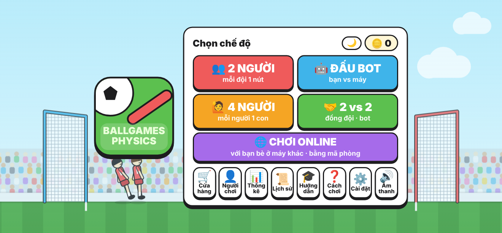
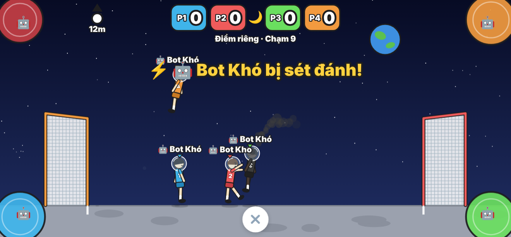
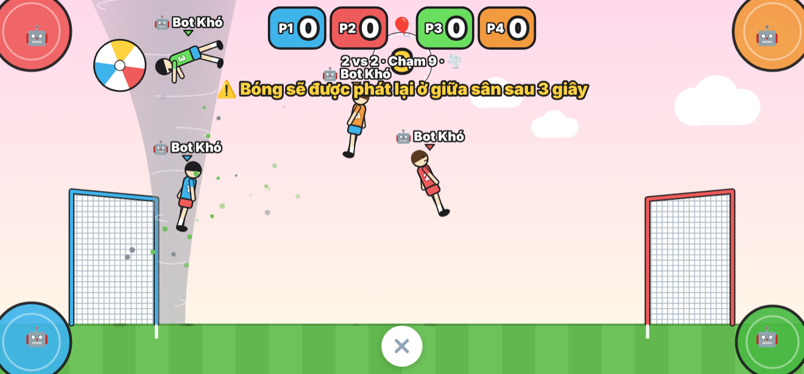
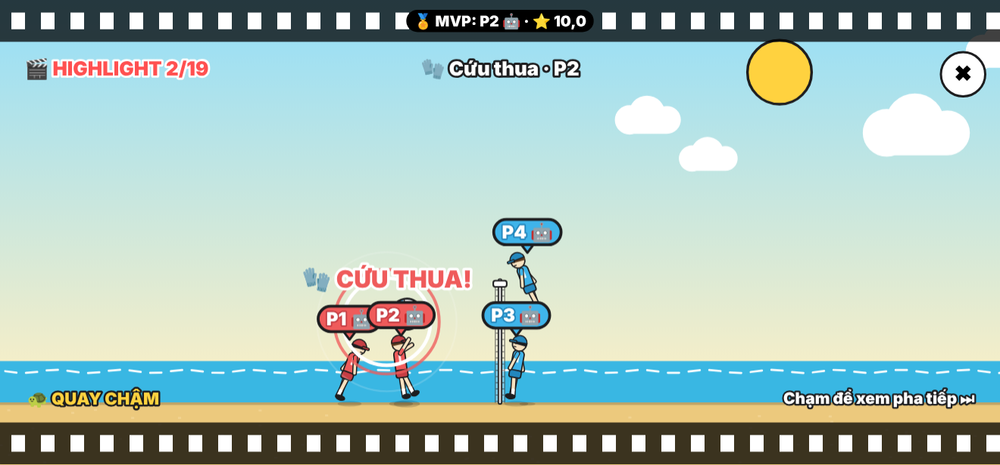
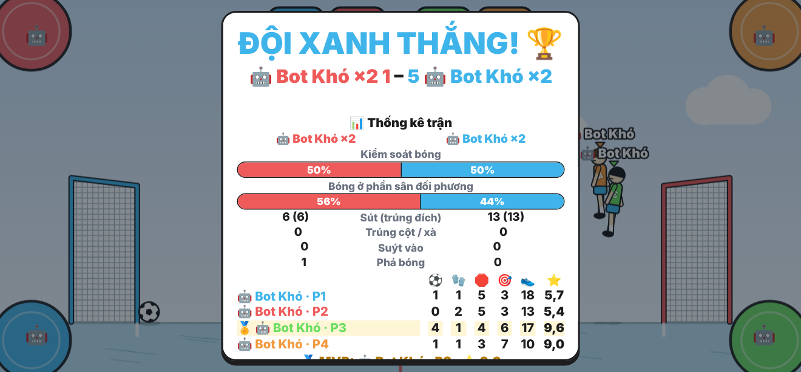
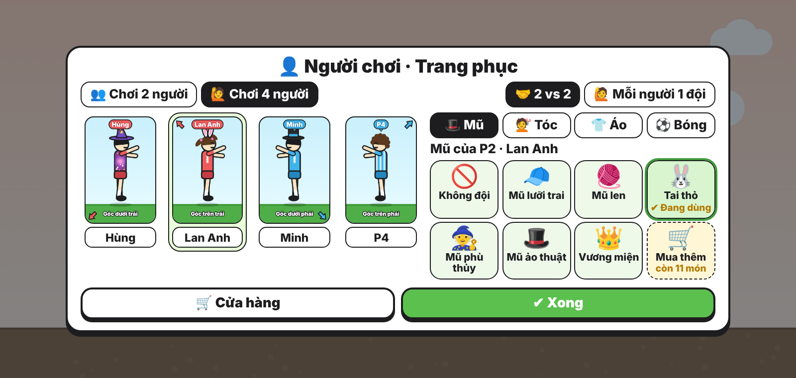

# ⚽ Ballgames Physics – v3.4

Game thể thao ragdoll vui nhộn: 2 đội × 2 cầu thủ, mỗi đội chỉ **1 nút**.

## 📥 Tải về
- 📱 **Android:** [tải APK](https://github.com/hungpt06013/ballgames-physics/releases/latest/download/BallgamesPhysics.apk) – cài đè lên bản cũ, giữ nguyên dữ liệu
- 🌐 **Chơi online:** https://hungpt06013.github.io/ballgames-physics/
- 💻 **Chơi offline trên máy tính:** tải [BallgamesPhysics.html](https://github.com/hungpt06013/ballgames-physics/raw/main/dist/BallgamesPhysics.html) rồi mở bằng Chrome

| | |
|---|---|
|  |  |
|  |  |
|  |  |

## 🎮 Cách chơi
| | |
|---|---|
| 👆 **Bấm** | nhảy + vung chân sút |
| ✊ **Giữ khi đang bay** | lộn người – móc xe đạp |
| ↗️ **Mẹo** | bấm lúc người nghiêng về trước để lao lên |
| 💤 **Đứng im 3 giây** | ngủ gật – bấm 1 cái để tỉnh (không nhảy) |
| 🦵 **Giữ nút quá 5 giây** | chân mỏi, tự hạ xuống |

**Chạm:** đấu bot – đâu cũng được · 2 người – nửa trái / phải · 4 người – mỗi người 1 góc.
**Bàn phím:** Đỏ `A` `W` `Space` · Xanh `L` `↑` `Enter` · 4 người `A` `G` `K` `↑` · `Esc` tạm dừng.

## 🏟️ 8 môn
⚽ Bóng đá · 🏀 Bóng rổ · 🏈 Bóng bầu dục · 🏐 Bóng chuyền bãi biển · 🌙 Bóng đá Mặt Trăng · 🧊 Sân băng · 🎈 Bóng khổng lồ · 💣 Bóng bom (bom nổ bên sân ai thì người đó thua)

## 👥 Chế độ
- 🤖 Đấu bot (Dễ / Thường / Khó) · 👥 2 người · 🙋 4 người · 🤝 2 vs 2
- Ở 2 người / 4 người / 2 vs 2, chạm vào ô từng người để đổi: người → bot Dễ → Thường → Khó. Mỗi bot một độ khó riêng; để tất cả là bot thì ngồi xem
- Thắng khi đủ điểm hoặc hết giờ; hết giờ mà hoà thì chọn 🤝 hoà hay ⭐ bàn vàng
- 🎓 Hướng dẫn 3 bước cho người mới

## ✨ Trong trận (bật / tắt khi tạo trận)
- 🎁 **Vật phẩm:** 🔥 siêu sút · 🛡️ khiên · 🧲 nam châm · ❄️ đóng băng · 🍄 phóng to
- 🎲 **Biến thể:** 2 bóng · người khổng lồ / tí hon · sàn nhún · xà di động · bóng siêu nảy · trọng lực thấp · quay chậm
- ⛈️ **Thời tiết:** 🌫️ sương mù · 🏚️ động đất · ⚡ sấm sét · 🌪️ lốc xoáy

## 🏆 Sau trận
- 📊 Thống kê từng người + 🏅 MVP
- 🎬 Highlight (bàn thắng, cứu thua, suýt vào) – tải về thành video MP4
- 📜 Lịch sử trận · 🛒 Cửa hàng trang phục · ⚙️ Cài đặt vật lý · 🌙 Giao diện tối

## 🛠️ Cho người sửa game
- Code nằm trong `www/`: `engine.js` (vật lý, bot), `game.js` (luồng game), `draw.js` (hình), `audio.js` (âm thanh). Mở `www/index.html` bằng Chrome là chơi được.
- Kiểm tra: `node test/sanity2.cjs`; các bài dùng Playwright như `node test/cases.cjs`.
- **APK:** GitHub tự build và ký mỗi khi đẩy code (khoá nằm trong secret `KEYSTORE_B64`, không có trong repo). Ra bản mới thì tăng `VERSION_CODE` trong `android/version.env`.
- File HTML chơi offline: `python3 build_html.py dist/BallgamesPhysics.html`
- Mọi luật chính xác và ghi chú kỹ thuật: [CHI_TIET.md](CHI_TIET.md)
