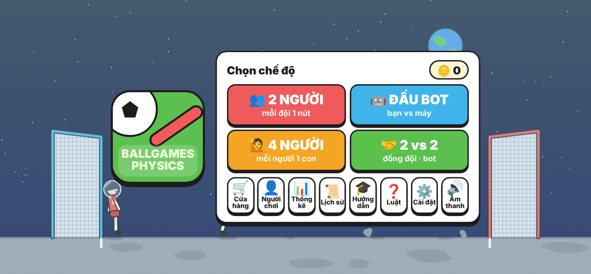
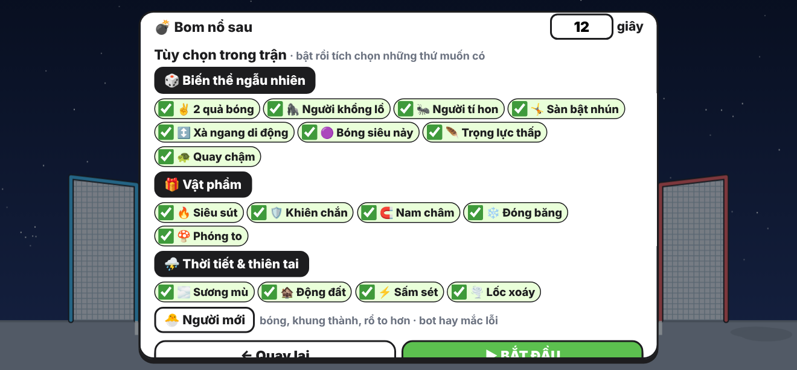
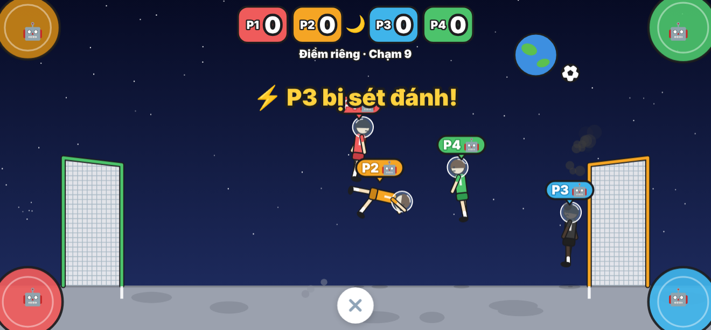
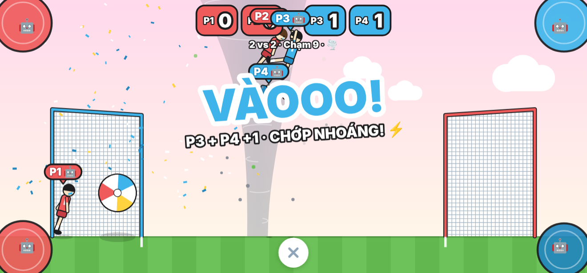
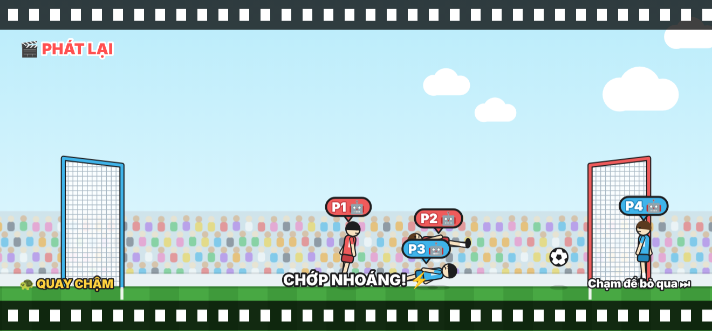
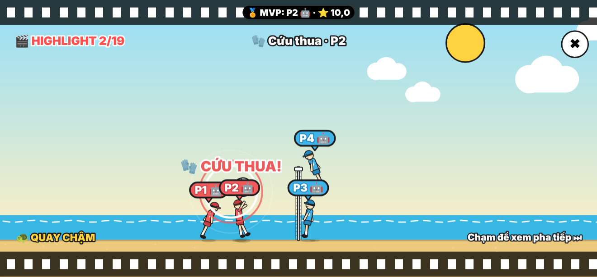
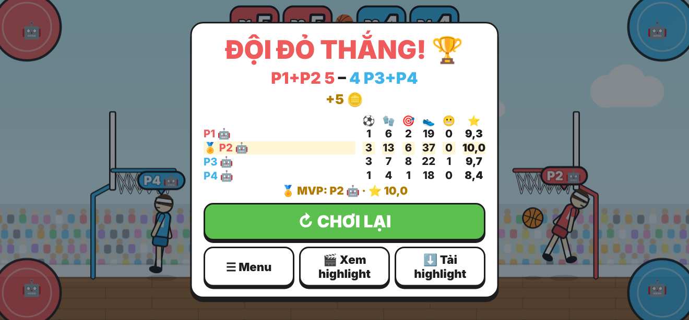
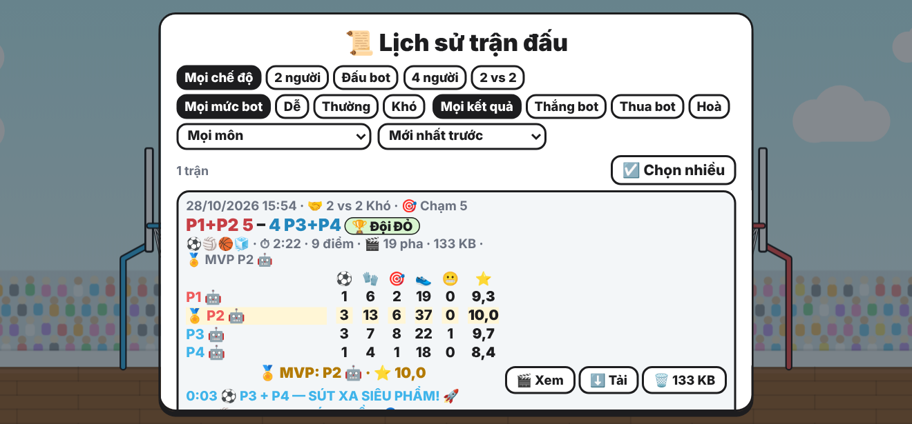

# Ballgames Physics (bản tự làm) – v2.8

Game 2 đội × 2 cầu thủ ragdoll, mỗi đội **1 nút** (bấm = nhảy + vung chân sút, giữ khi đang bay = xoay người).
Khi vào trận, tích chọn các môn muốn chơi; chọn nhiều môn thì sau mỗi điểm đổi sang môn khác.

## Tải về / chơi thử
- **Android**: [BallgamesPhysics.apk](https://github.com/hungpt06013/ballgames-physics/raw/main/dist/BallgamesPhysics.apk) (Android 5.0 trở lên; nếu trình duyệt tải về thành `.apk.zip` thì giải nén ra hoặc đổi tên lại thành `.apk`).
- **Trình duyệt** (1 file, chơi offline): [BallgamesPhysics.html](https://github.com/hungpt06013/ballgames-physics/raw/main/dist/BallgamesPhysics.html) – tải về rồi mở bằng Chrome.
- **Chơi online** (khi đã bật GitHub Pages cho thư mục `docs/`): https://hungpt06013.github.io/ballgames-physics/

| | |
|---|---|
|  |  |
|  |  |
|  |  |
|  |  |

## 8 môn
Bóng đá, bóng rổ, bóng bầu dục, bóng chuyền bãi biển, bóng đá Mặt Trăng, sân băng, bóng khổng lồ,
**bóng bom** (bom 12 giây, nổ bên sân ai thì người đó thua).
Khung thành bóng đá / Mặt Trăng cao 330 (bản cũ 250); bóng khổng lồ cao 400, sâu 300 (bản cũ 180). Khung thành luôn sâu hơn đường kính quả bóng ít nhất 70, nên dù chỉnh cỡ bóng tối đa (×1,6) và bật người mới thì bóng vẫn lọt hẳn vào được; chế độ người mới làm khung cao hơn.
Các môn có khung thành (bóng đá, Mặt Trăng, sân băng, bóng khổng lồ): bàn thắng chỉ tính khi **cả quả bóng đã vượt qua vạch vôi** trước khung thành (vạch trắng trên sân).
Bóng rổ, bóng bầu dục: cầu thủ không đi ra sau cột rổ / cột dọc được, tối đa là đứng trên đỉnh cột.
Bóng được thả lại giữa sân khi nằm **ngoài biên** (trên nóc khung thành, sau cột rổ, sau cột bầu dục) đủ 3 giây, hoặc khi **nằm im 15 giây mà không ai chạm** (kể cả nằm vắt trên vạch vôi), ở mọi chế độ (người với người, đấu bot, 4 người, 2 vs 2); riêng bóng bom thì không, vì bom tự nổ.
3 giây trước khi thả lại, game báo "⚠️ Bóng sẽ được phát lại ở giữa sân sau 3… 2… 1 giây" (kèm tiếng bíp) và đánh dấu chỗ bóng sẽ rơi xuống.
Cầu thủ ngã (kể cả lộn ngược) tự bật dậy sau khoảng 0,3 giây và xoay vừa đủ để tiếp đất bằng chân; chạm nút lúc đang nằm cũng bật dậy ngay.

## Chế độ
- **2 người** – mỗi đội 1 nút (chạm nửa trái / nửa phải màn hình).
- **Đấu bot** – Dễ / Thường / Khó (bot mô phỏng vật lý trước để chọn lúc bấm).
- **4 người (điểm riêng)** và **2 vs 2** – mỗi người 1 góc màn hình; ô trống có thể để **bot** (vd. 2 người chung đội đấu 2 bot).
  Khung thành mang màu người chạm bóng cuối; sau mỗi ván người trước/sau đổi chỗ.
- **Hướng dẫn** 3 bước tương tác (nhảy → sút → xoay người), lần đầu xong được +30 xu.
- Thể thức: tự nhập **số điểm để thắng** (1–99) hoặc **số phút** (0,5–60). Chọn môn bóng bom thì nhập được **số giây trước khi bom nổ** (3–60).
- Hết giờ mà đang hoà: **mỗi người chơi chọn** 🤝 hoà hay ⭐ bàn thắng vàng (bot không chọn). Số người chọn bàn vàng ≥ số người chọn hoà thì đá tiếp, ai ghi trước thắng; không thì trận kết thúc với tỉ số hoà.

## Trong trận
- **Biến thể ngẫu nhiên** mỗi ván: 2 quả bóng, người khổng lồ/tí hon, sàn bật nhún, xà ngang di động, bóng siêu nảy, trọng lực thấp, quay chậm.
- **Vật phẩm** rơi bằng dù: 🔥 siêu sút, 🛡️ khiên chắn khung thành, 🧲 nam châm hút bóng, ❄️ đóng băng đối thủ, 🍄 phóng to.
- **Thời tiết & thiên tai**:
  - 🌫️ sương mù: cứ 5–10 giây lại mờ đi khoảng 6 giây.
  - 🏚️ động đất: 8–15 giây một lần, rung 10 giây, đất văng, mọi người lắc lư nhưng vẫn điều khiển được.
  - ⚡ sấm sét: 8–15 giây một lần, có mây và vòng vàng báo trước 0,8 giây.
    - Trúng đất: thành hố 5 giây.
    - Trúng người: cháy đen, đứng im 5 giây.
    - Trúng bóng: 5 giây sau dừng ván, không ai được điểm, phát lại cú sét, đá lại cùng môn.
    - Trúng bom: nổ luôn, không ai được điểm.
  - 🌪️ lốc xoáy: 8–15 giây một lần, ở một phần tư sân bất kỳ, hút người và bóng lên rồi xoay khoảng 6 giây; khung thành không bị ảnh hưởng.
  - Đếm giờ chỉ chạy khi không có hiện tượng nào. Khi một hiện tượng đến: 90% các bộ đếm khác reset (chỉ có 1 hiện tượng), 9% có 2 hiện tượng cùng lúc, 0,9% có 3, 0,1% có cả 4.
- Mỗi mục trên bật/tắt riêng, và khi bật thì **tích chọn từng thứ** muốn có.
- **Phát lại** mỗi bàn thắng (chạm để bỏ qua): bắt đầu từ 5 giây trước cú chạm bóng cuối của bên được điểm (với phản lưới là cú sút trúng người bên kia rồi vào lưới), chạy tốc độ thường rồi quay chậm từ ngay trước cú sút (nhiều nhất 2,5 giây trước khi bóng vào) và chậm luôn tới hết phát lại, lúc bóng vào có vòng sáng và chữ "VÀO!" ngay chỗ quả bóng; vật phẩm, khiên, đóng băng, phóng to, thời tiết hiện đúng như lúc diễn ra; bóng hay người bay lên trời có mũi tên ngay dưới vạch đen; kèm bình luận: phản lưới, xe đạp chổng ngược (chỉ khi thật sự lộn ngược trên không: đầu thấp hơn hông, đang bay, chân vung lên), đánh đầu, sút xa, chớp nhoáng…
- Cầu thủ có **nét mặt** (gắng sức, vui, buồn, choáng, lạnh cóng), đội ghi bàn ăn mừng, khán giả nhảy múa.
- **Nhạc nền** tự tạo theo môn + tiếng khán giả; bật/tắt riêng nhạc và hiệu ứng.

## Sau mỗi trận đấu
Một trận là từ lúc bắt đầu đến khi có người chạm mốc điểm / hết giờ / hoà (không phải từng bàn).
- **Thống kê từng người**: ⚽ bàn thắng · 🧤 cứu thua · 🎯 sút trúng đích · 👟 chạm bóng · 😬 phản lưới (nếu có) và **⭐ điểm** (3,0–10,0; trận bình thường khoảng 6), người điểm cao nhất là **🏅 MVP**.
  Kết quả và cách biệt tỉ số ảnh hưởng nhiều nhất (thua 1–6 chỉ còn khoảng 4 điểm, thắng đậm khoảng 9–10), sau đó tới bàn thắng, cứu thua, sút trúng đích, chạm bóng; phản lưới bị trừ nặng.
  Ở chế độ 2 người / đấu bot mỗi bên là 1 người (1 nút điều khiển cả 2 cầu thủ); ở 4 người / 2 vs 2 mỗi ô là 1 người.
- **🎬 Highlight**: mọi bàn thắng, các ván bị dừng vì sét đánh trúng bóng, những pha **cứu thua** và những pha **suýt vào**.
  Cứu thua = bóng sắp vào trong khoảng 1 giây thì bị cầu thủ bên kia chặn lại bằng chân / đầu / người, **ở nửa sân nhà**, và người đó **có bấm nút** (nhảy, sút, đánh đầu, lao người) ngay trước lúc chạm bóng. Đứng yên để bóng đập vào người, khiên chắn, hay chặn bóng bên nửa sân đối phương thì không tính.
  Các pha cứu thua liên tiếp (cách nhau dưới 3 giây, cùng một bên) gộp thành 1 pha lớn và luôn có trong highlight; với các pha cứu thua lẻ, giữ khoảng 1/3 pha nguy hiểm nhất.
  Suýt vào = cú sút không vào (và không ai chạm vào bóng trước khi nó tới khung thành / rổ / cột) nhưng chỉ cần mạnh / nhẹ hơn tối đa 10% hoặc lệch góc tối đa khoảng 3° là đã vào: dội cột, sượt xà, bóng xoay ra khỏi vành rổ… Mỗi pha được chấm điểm đẹp (càng sát càng cao, cộng thêm khi dội cột / vành, sút xa, sút trên không, sút mạnh) và highlight lấy **20% pha đẹp nhất** (làm tròn lên).
  Pha nào cũng có quay chậm lúc vào lưới / lúc cứu thua / lúc suýt vào. Các pha chồng lên nhau trong cùng một ván (vd. cứu thua rồi phản công ghi bàn luôn) được gộp thành 1 đoạn, không chiếu 2 lần. Xem ngay ở màn hình cuối trận hoặc trong Lịch sử (chạm để sang pha tiếp, ✖ để thoát).
- **⬇️ Tải highlight**: tạo video WebM của highlight trận đó (mất khoảng bằng thời lượng highlight, vài MB). Điện thoại: lưu vào **Movies/Ballgames** (Android 9 trở xuống sẽ hỏi quyền bộ nhớ; nếu từ chối thì lưu vào thư mục riêng của app). Trình duyệt: tải về như file bình thường.
- **📜 Lịch sử trận đấu**: ngày giờ, chế độ, mức bot, thể thức, các môn, tỉ số, thắng/thua/hoà, thời lượng, danh sách bàn thắng, bảng thống kê. Lọc theo chế độ (2 người / đấu bot / 4 người / 2 vs 2), mức bot (Dễ / Thường / Khó), kết quả (thắng bot / thua bot / hoà), môn; sắp xếp mới nhất / cũ nhất / cách biệt nhiều nhất. Lưu tối đa 500 trận.
- **Lưu highlight**: lần đầu đấu xong game hỏi 1 lần: 💾 lưu tất cả / 🔢 chỉ lưu N trận gần nhất (1–100) / 🚫 không lưu (chỉ xem / tải ngay sau trận). Đổi lại trong ⚙️ Cài đặt (có xác nhận trước khi xoá bớt). Mỗi trận khoảng 0,05–0,2 MB. Bản điện thoại lưu trong máy, bản web lưu trong trình duyệt.
  Xoá để giải phóng bộ nhớ: 🗑️ từng trận trong Lịch sử, ☑️ chọn nhiều trận rồi xoá, hoặc 🗑️ xoá tất cả trong Cài đặt (tuỳ chọn xoá luôn lịch sử). Trận đã xoá highlight vẫn còn trong lịch sử; video đã tải về không bị ảnh hưởng.

## Ngoài trận
- **Xu & cửa hàng**: mũ, tóc, áo, skin bóng. Xu nhận khi thắng bot (Dễ 10 / Thường 20 / Khó 40), ghi bàn, chơi 2/4 người, học xong hướng dẫn.
- **Người chơi**: đặt tên + màu áo + trang phục cho P1–P4 (xem trước hình).
- **Thống kê**: số trận, thắng/thua/hoà từng mức bot, chuỗi thắng bot Khó, tổng bàn, môn ghi nhiều nhất, bàn nhanh nhất.
- **Cài đặt**: lực nhảy, lực sút, trọng lực, độ nảy, cỡ bóng, tốc độ game, **độ trễ nhảy**, **độ dài tối thiểu 1 lần chạm**, bật/tắt phát lại, nhạc, hiệu ứng.
- **Chế độ người mới**: bóng/khung thành/rổ to hơn, bot hay mắc lỗi hơn.
- **🌙 Giao diện sáng / tối**: nút 🌙 / ☀️ trên menu hoặc trong ⚙️ Cài đặt; chưa chọn thì theo điện thoại. Giao diện tối đổi màu các bảng và làm sân tối lại như đá đêm.

Dữ liệu (xu, đồ, thống kê, cài đặt, lịch sử) lưu trong máy (localStorage; highlight trong IndexedDB trên web, trong bộ nhớ app trên Android); cập nhật từ bản cũ vẫn giữ cài đặt.

## Cấu trúc
- `www/engine.js` – engine vật lý (thân cứng + va chạm), 8 môn (`MAPS`), biến thể (`MODS`), vật phẩm (`ITEMS`), bot AI (`LEVELS`, `Bot`).
- `www/game.js` – luồng game, điều khiển, HUD, menu, phát lại, hướng dẫn, phát hiện cứu thua, highlight, lịch sử, thống kê trận, bình chọn khi hết giờ hoà, xuất video.
- `www/highlights.js` – nén khung hình highlight (30 hình/giây, số nguyên 16 bit, delta + gzip), lưu trữ (IndexedDB / file trong app) và lịch sử trận.
- `www/draw.js` – vẽ sân, cầu thủ (mặt, mũ, tóc, áo), bóng, khán giả.
- `www/audio.js` – hiệu ứng âm thanh, nhạc nền, tiếng khán giả (Web Audio, không cần file âm thanh).
- `www/meta.js` – xu, cửa hàng, hồ sơ người chơi, thống kê.
- `www/index.html` – giao diện menu.
- `android/` – vỏ Android (WebView toàn màn hình, khoá màn hình ngang, nút Back, cầu nối `BGNative` để lưu highlight và video).
- `build_apk.sh` – build APK không cần Gradle (aapt2 → javac → d8 → zipalign → apksigner).
- `build_html.py` – gộp thành 1 file HTML chơi trên trình duyệt.
- `test/` – kiểm tra vật lý (`sanity2.cjs`), bot đấu nhau (`match2.cjs`), kiểm tra giao diện bằng Playwright (`v21.cjs`, `v22.cjs`, `v23.cjs`, `flow2.cjs`, `tut.cjs`, `migrate.cjs`), thời gian đứng dậy sau khi ngã (`getup.cjs`), thiên tai (`hazards.cjs`), bóng mọi cỡ đều vào được khung thành (`goalfit.cjs`), quay chậm liền mạch (`slowmo.cjs`), lời bình xe đạp chổng ngược (`bicycle.cjs`), highlight / lịch sử / thống kê / bình chọn / xuất video (`v25.cjs`), luật cứu thua, gộp pha trùng, cách tính điểm (`v26.cjs`), bóng nằm im 15 giây được thả lại (`stillball.cjs`), báo trước khi thả lại bóng, pha suýt vào, giao diện tối (`v28.cjs`), đường đi của bản Android với cầu nối giả lập (`native.cjs`), dung lượng highlight (`hlsize.cjs`).

## Tuỳ chỉnh vật lý
Trong game: Menu → ⚙️ Cài đặt.
Trong code: sửa từng môn ở `MAPS` trong `www/engine.js` (`g`, `gBall`, `jump`, `legSpd`, `ballR`, `ballE`, `mu`…).

## Build
Cần JDK 17+ và Android SDK (build-tools 36.1.0, platforms;android-34):
```
ANDROID_HOME=/đường/dẫn/sdk VERSION_CODE=15 VERSION_NAME=2.8 ./build_apk.sh
python3 build_html.py BallgamesPhysics.html
```
Chạy kiểm tra: `node test/sanity2.cjs` (engine), các file Playwright như `node test/v25.cjs` (cần `npm i -g playwright` và Chromium).

**Khoá ký APK** (`release.jks`) **không có trong repo**. `build_apk.sh` tự tạo khoá mới nếu chưa có; muốn bản build cài đè lên bản đã cài thì phải dùng đúng khoá cũ (giữ file này ở chỗ riêng, đừng đưa lên mạng).
